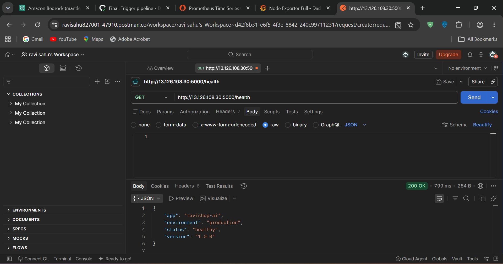
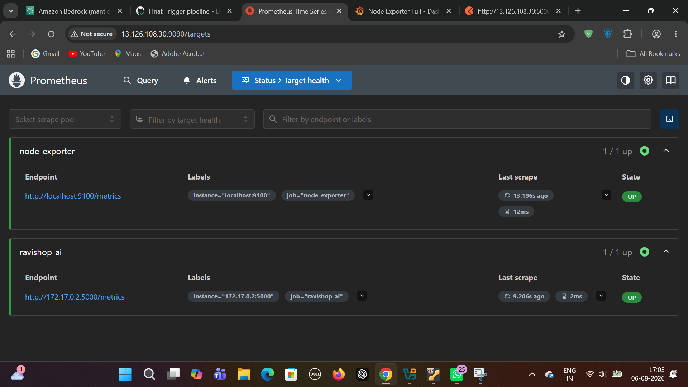

# RaviShop AI 2026

AI-driven DevOps platform: a Flask API with an AI agent (AWS Bedrock Mantle, `openai.gpt-oss-120b`) that debugs errors, checks logs, detects anomalies and triggers auto-healing, wrapped in a full CI/CD and DevSecOps pipeline.

## Related repositories

| Repo | Purpose |
|------|---------|
| ravishop-ai-app (this repo) | Flask API, AI agent, Dockerfile, CI/CD pipeline |
| ravishop-ai-infra | Terraform (VPC, EC2, RDS, IAM) and Ansible roles |
| ravishop-ai-k8s | Kubernetes manifests, Argo CD config, monitoring config |

## Tech stack

- **App:** Python 3.11, Flask, Prometheus client
- **AI:** AWS Bedrock Mantle (OpenAI SDK compatible)
- **Containers:** Docker, Docker Compose, AWS ECR
- **IaC:** Terraform, Ansible
- **CI/CD:** GitHub Actions
- **DevSecOps:** Gitleaks, flake8, Checkov, Trivy, Grype, SonarCloud
- **Monitoring:** Prometheus, Grafana, Node Exporter, CloudWatch
- **GitOps (config only):** Kubernetes manifests, Argo CD

## API endpoints

| Endpoint | Description |
|----------|-------------|
| `/health` | Health check |
| `/` | Service info |
| `/ask` | Ask the AI agent |
| `/debug` | AI error debugging |
| `/infra/status` | Infrastructure status |
| `/deploy/advice` | Deployment advice |
| `/cost/optimize` | Cost optimization tips |
| `/security/scan` | Security scan summary |
| `/logs/check` | Log analysis |
| `/metrics` | Prometheus metrics |
| `/anomaly/detect` | Anomaly detection |
| `/anomaly/heal` | Auto-heal action |

## CI/CD pipeline

On every push, GitHub Actions runs:

1. Gitleaks (secret scan)
2. flake8 (lint)
3. Checkov (IaC scan)
4. Trivy and Grype (image vulnerability scan)
5. Docker build and push to ECR (tagged with the commit SHA)

## Run locally

```bash
git clone https://github.com/Ravisahu7079/ravishop-ai-app.git
cd ravishop-ai-app
python3 -m venv venv && source venv/bin/activate
pip install -r requirements.txt
python app.py
```

Create a `.env` file (never commit it):

```
DB_USER=<your-db-user>
DB_PASSWORD=<your-strong-password>
DB_NAME=<your-db-name>
```

Run with Docker Compose:

```bash
docker compose up -d
```

## Security notes

- Secrets live in `.env` / `terraform.tfvars`, which are gitignored.
- A hardcoded DB password was found in an earlier commit; it was removed from the code and from git history. It belonged to a practice database that has since been destroyed.

## Project status

All AWS resources from the live deployment have been destroyed to avoid cost. The infrastructure is fully reproducible from the `ravishop-ai-infra` repo.

Kubernetes and Argo CD manifests are provided as configuration only and were not deployed live.

## Screenshots

### CI/CD pipeline (GitHub Actions)


### AI agent (AWS Bedrock Mantle)


### API test (Postman)





### Monitoring: Grafana


### Monitoring: Prometheus





### Infrastructure as Code: Terraform


### AWS: ECR image and EC2 instance


## Author

Ravi Sahu, [@Ravisahu7079](https://github.com/Ravisahu7079)
